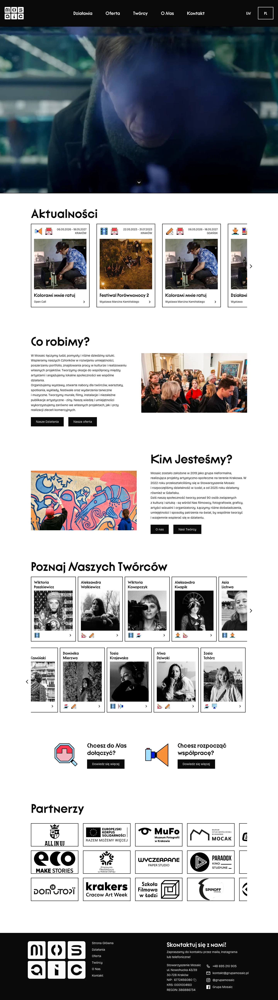
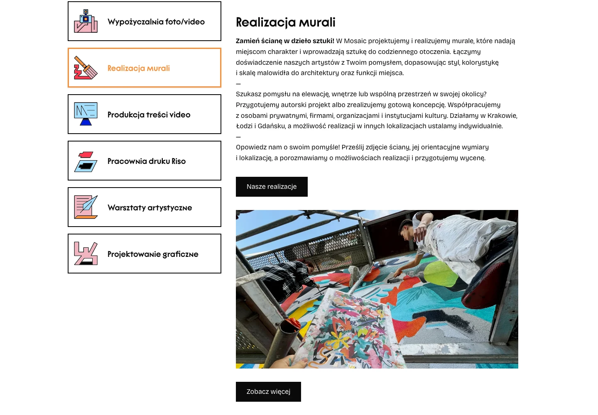
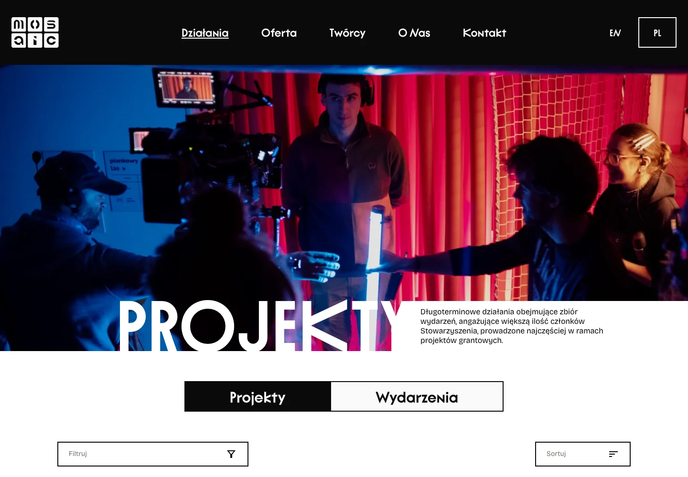
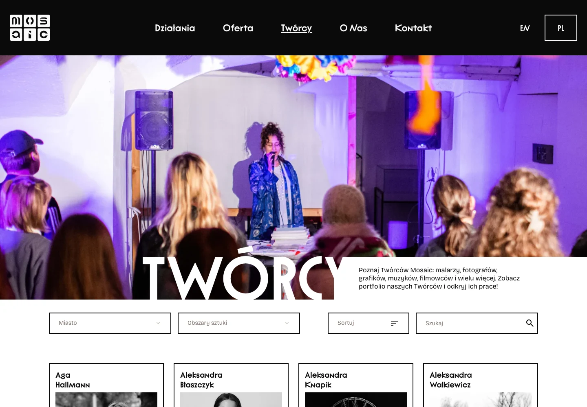
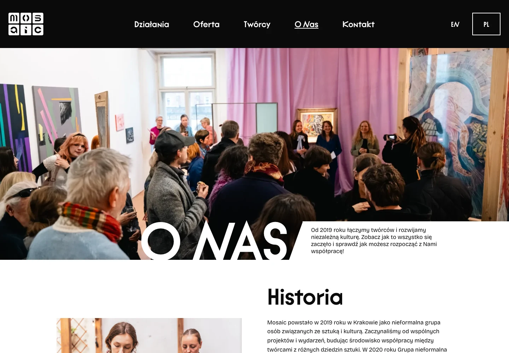
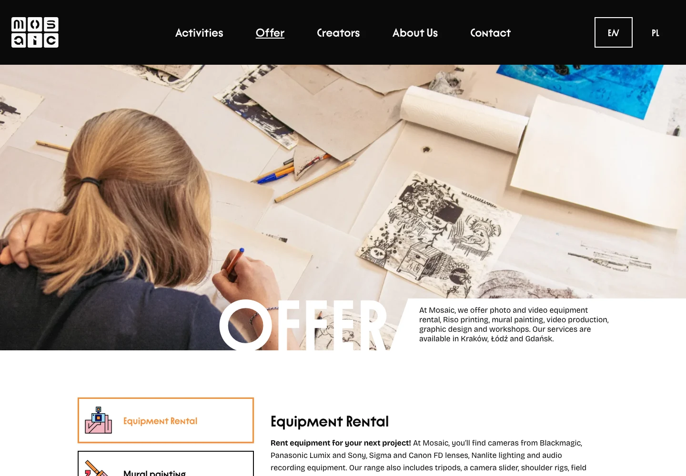

# Grupa Mosaic

Strona wykonana w oparciu o dostarczony projekt w Figmie.\
Strona i CMS zostały skończone i oddane.\
Strona widnieje jako „w budowie”, ponieważ trwa uzupełnianie treści.

Strona: [grupamosaic.pl](https://grupamosaic.pl)

Stack: Next.js 16, React 19, TypeScript, Tailwind CSS 4, Sanity CMS (GROQ), next-intl, Cloudflare Workers (OpenNext)

## Podgląd interfejsu

### Strona główna

### Oferta

Zakładki porządkują ofertę, a wybór pozycji zmienia opis i galerię.

### Działania i twórcy

### O grupie

### Wersja angielska

